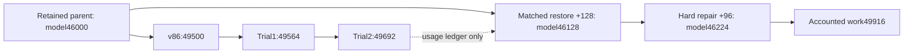

# Английская модель — ремонт за 2026-11-25

**Полноценное исправление качества не подтверждено.** Исправлен контроль дальнейшего ухудшения исходной v86; её реальное состояние остановлено и долговременно сохранено без новых градиентов. Последний экспериментальный кандидат немного улучшил обе метрики на известном внешнем наборе, но не прошёл заранее объявленную development-проверку обнаружения. Он не выбран основной моделью и не принят в продукт.

## Исправление исходной v86

[Фактический run45569472894](https://github.com/Kirusha-dk/MailGuard/actions/runs/45569472894): completed/success, **0 новых optimizer steps**, global49500 = inherited46000 + phase3500,7 завершённых дат, последняя обученная дата24 ноября. Новых core/support строк0, изменений LoRA0/24. Скачанный checkpoint побитово сравнен с исходным по adapter,26 Adam states,scheduler,RNG,metadata,order/cursor/exposures/hard_indices и завершённым датам: изменились только stop/report flags.

Убрано исключение epoch0 из patience; preflight останавливает уже накопленную регрессию до новых градиентов. Отбор best дополнительно защищает fixed TP/FP, fitted98 FP и log-loss. Expected_min_step поднят49000→49500; исходные session_id,8000/500 budgets,campaign/start/end,parent и frozen данные сохранены. [Quality-stop prerelease](https://github.com/Kirusha-dk/MailGuard/releases/tag/v86-experiment-2026-11-24-quality-stop) скачан и проверен; старый weekly пакет не перезаписан. Управляющий v86 приостановлен, новых месяцев/tasks/cron нет. v82/RU/ES/TR/Korean не менялись этим ремонтом.

## Реально выполненные исследования

Всего416 optimizer steps на CPU:64+128+128+96. В первых двух попытках продолжались собственные Adam/RNG из последнего v86; затем явно восстановлен целый согласованный parent46000 (веса **и** его Adam/RNG), а usage ledger перенесён из всех более поздних попыток. Новые scheduler/objective объявлены отдельно. Backbone all-MiniLM-L6-v2 revision1110a243fdf4706b3f48f1d95db1a4f5529b4d41 заморожен; обновлялись24LoRA и head. Последняя попытка использовала только TRAIN-ошибки/низкие margins и более быстрый head, сохранив все26 Adam moments при разбиении на группы24+2.

| Попытка | Шаги | SELECT fitted98 FP /12201 HAM | Итог |
|---|---:|---:|---|
| Pilot64 | 64 | 758 | Не прошла development gate |
| Domain replay128 | 128 | 718 | Не прошла development gate |
| Matched-parent128 | 128 | 582 | Не прошла development gate |
| Hard replay/head96 | 96 | 628 | Не прошла development gate |

Сохранённый parent: fitted98 TP10378/FP548/FN211/TN11653. Последняя исходная v86: TP10378/FP806/FN211/TN11395. Все fitted-точки выбраны на прежнем SELECT22790 development; они не являются независимым переносом98%.

Оригинальные100000 новых писем и92890 HAM support не переопределялись. Отдельные repair manifests используют прежние допустимые TRAIN и размеченный native-English v85 TRAIN, плюс не использованные в контроле2026 archive SPAM. TRAIN-метки не подменялись предсказаниями.2026 pool426 исключён относительно control identity/family/20-word windows. Новые подвыборки не выдаются за100000 новых писем. Никакой клиентской почты, SMS/чатов, переводов или синтетических писем в градиентах нет.

### Учёт состояния при согласованном восстановлении

**46224** — реальный счётчик Adam/линии последнего кандидата. **49916** — вся учтённая работа, включая3692 отклонённых обновления. Отдельная recovery-ветка не подставлялась в v86 как якобы новый checkpoint49500+. Оригинальная v86 остановлена на49500. Канонические счётчики включают и отклонённые попытки: максимум3, без возврата allowance при старых весах. Собственные cursor/RNG/optimizer и исходные ledgers сохранены. Потеря собственного checkpoint запрещает холодный перезапуск.

## Дополнительный development выявил регрессию

v85 SELECT699:89 SPAM/PHISHING и610 HAM. Это development, не независимый тест. Порог0.04897100105881691:

| Вариант | TP | FP/HAM | FN | TN |
|---|---:|---:|---:|---:|
| Retained parent |82|76/610|7|534|
| Последний repair-кандидат |76|54/610|13|556|

Ложных срабатываний меньше, но обнаружений82→76. В этом положительном классе смешаны phishing IWSPA и SPAM CSDMC; не утверждается, что все89 примеров являются только phishing. Предварительно объявленные условия gate не достигнуты; retained parent остаётся выбранным. Порог по внешнему контролю не подбирался.

## Полная внешняя диагностика последнего фиксированного кандидата

20630 тех же нормализованных английских писем:20065 SPAM/PHISHING и565 HAM. После разработки это **регрессионный контроль**, не новый независимый TEST. Последний кандидат зафиксирован до его прохода; после него новых оптимизаций не выполнялось. Development-решение об отклонении не менялось по результату внешнего набора.

| Вариант / порог | TP | FP /565 HAM | FN | TN | Recall | HAM specificity | FPR |
|---|---:|---:|---:|---:|---:|---:|---:|
|Исходная последняя v86 / fixed|11102|60/565|8963|505|55.33%|89.38%|10.62%|
|Последний кандидат / fixed|11199|46/565|8866|519|55.81%|91.86%|8.14%|
|Исходная v86 / свой старый SELECT cutoff|13851|183/565|6214|382|69.03%|67.61%|32.39%|
|Последний кандидат / свой SELECT cutoff|12232|58/565|7833|507|60.96%|89.73%|10.27%|

При одинаковом fixed cutoff прирост SPAM-обнаружений97, ложных HAM-флагов на14 меньше. Это небольшой наблюдаемый выигрыш, а не подтверждение полноценного исправления. Большинство SPAM-меток — слабые trap labels; HAM565 в основном из другого источника и периода. Семантическая независимость всех near duplicates не установлена. Реальная почта заказчика и10ppm не измерялись. Предыдущий отчёт оценивал last working checkpoints; retained best adapters отдельно сохранялись.

## Артефакт и проверка загрузки

Архив: `/workspace/artifacts/mailguard-english-repair-experiment-20261125.zip`, SHA256 `9f022a6cd2c8fccc1b3ae824cfe03004eaaaaa7f8ff22caf4af2d8b3d299dc29`, 98232949 bytes,40 файлов. Все внутренние SHA256 проверены. Кандидат и retained загружены **из распакованного архива** без сети; по32 публичным нормализованным строкам выход совпал с измеренным с ошибкой<1e-5. Новых градиентов в проверке0.

В архиве полный pinned backbone с Apache2 licence/model card, оба адаптера, все собственные optimizer/RNG checkpoints и история отклонённых попыток, metadata и source frozen manifests. Сырых писем нет. Default variant — retained; кандидат явно помечен как не прошедший gate. Это не установка в продукт.

[Постоянный резервный пакет](https://github.com/Kirusha-dk/MailGuard/releases/tag/v87-best-recovery-20261124) также скачан и проверен. Веса/состояния не помещались в Git. Исходные условия email-источников и неполный provenance Merged-public сохраняются; CSDMC mirror software licence не означает прав на все email, IWSPA standard licence не установлена.

[Draft PR13](https://github.com/Kirusha-dk/MailGuard/pull/13) и PR12 остаются unmerged. Исправление остановки применено в самой экспериментальной v86-ветке; остальные исследования изолированы.
